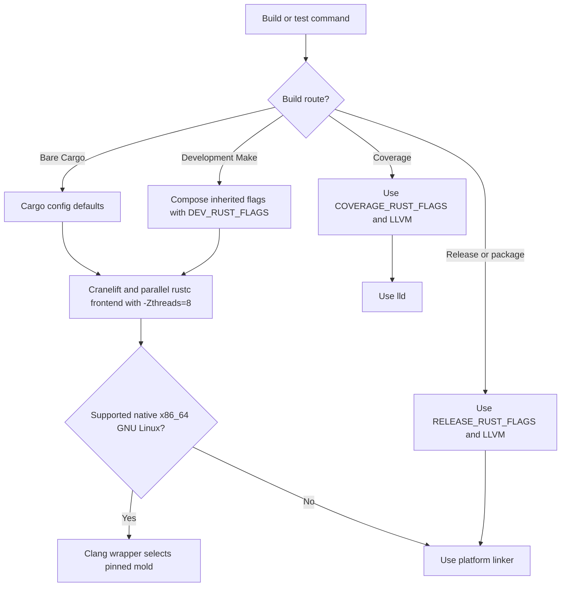

# Developer guide

This guide explains the contributor workflow for Combobulate's current
scaffold. The [technical design](technical-design.md) describes proposed array
and typed-collection contracts. Consult the
[repository layout](repository-layout.md) for file ownership and the
[GIST roadmap](roadmap.md) for delivery sequencing. The current library remains
a stub; the proposed API is not available.

Implementation must follow the design's proof-first obligations: select a
property and its verifier before implementing covered behaviour, provide a
non-vacuity control, and bind actual evidence to the tested source and
toolchain. Documentation checks do not establish a Rust proof or a backend
capability.

## Local Workflow

After rendering a project, initialize version control and stage its files
before running repository gates:

```sh
git init
git add -A
```

The following workflow describes contributor checks and their file-selection
rules.

Use `make all` as the public entrypoint for formatting, linting, tests, and
spelling. It runs these gates one at a time even when invoked with `make -j`.
`make lint` runs `lint-clippy` (rustdoc, then Clippy), `lint-whitaker`, and
`lint-python` in sequence, also under `make -j`. The Python stage runs
Interrogate 1.7.0 with a 100% threshold. It discovers tracked and non-ignored
untracked `.py` and `.pyi` files through Git, including hidden paths under
`.github/` and any scripts, tests, tools, or benchmarks. A failed source-list
command or empty source selection stops the gate rather than silently checking
an incomplete set or falling back to Interrogate's working-directory scan.
Whitaker's temporary Dylint driver is built outside the repository, so the
recipe removes inherited compiler and linker overrides before starting it.
Dylint then checks the repository from its root and discovers
`.cargo/config.toml`; that check uses the development backend and linker
defaults. The recipe sends warnings-as-errors to the repository check through
Dylint's `DYLINT_RUSTFLAGS` input. `make test` prefers `cargo nextest run` and
falls back to `cargo test` when cargo-nextest is not available. It prepares
both workspaces' dependencies and builds the cardinality probe's `trybuild` UI
gate before any test body runs, then the root test runs the binary Cargo
reported for its `#[must_use]` result contract. `make test-ui` prepares and
runs the same gate directly. See [Test timeouts](#test-timeouts) for why
preparation sits outside the suite and what bounds each child process.
`make check-fmt` verifies Rust formatting with `cargo fmt --all -- --check` and
Markdown formatting via `mdtablefix --check` using the configured selection and
formatting rules. `make fmt` formats Rust with the pinned `rustfmt`, then
applies the Markdown formatter and `markdownlint-cli2 --fix`. `make typecheck`
type-checks without building via `cargo check`. `make audit` derives the Rust
workspace root with `cargo metadata`, logs workspace member manifests, and runs
`cargo audit` once from the workspace root. PR CI skips `make audit` and the
audit-only setup when `github.actor` is `dependabot[bot]`; that keeps
whole-lockfile advisories from blocking unrelated Dependabot PRs while human
PRs retain the audit gate. The compensating control is
`.github/workflows/audit.yml`, which runs weekly and can also be triggered
manually. `make coverage` uses `cargo llvm-cov` with `lld` and prepares the
gate before measuring; see [Test timeouts](#test-timeouts) for why preparation
sits outside the suite.

`make check-fmt` checks Git-tracked Markdown and untracked files Git does not
ignore; files need not be staged. Markdown lint covers every matching file. The
spelling gate enumerates files with `git ls-files`, so it checks tracked files
only. Stage new documentation before relying on spelling results.

The first `make spelling` run regenerates the tracked `typos.toml`; commit that
generated file with the change. The gate derives it from the shared dictionary
and `typos.local.toml`, so add repository-specific exceptions to the local
overlay instead of editing generated output.

Every pull request runs three required hosted jobs: `build-test` on the
native-only profile, and `polars-lint` and `polars-test` on the Polars-enabled
profile. `polars-test` also runs `make test-profiles`, because neither required
job builds a single-feature profile and the modules gated on one would
otherwise never run. `build-test` is the authoritative repository gate. Its
Rust test suite includes workflow-structure and command contract tests:
workflow YAML and pins are checked from source, while real Make recipes and
shell scripts run with controlled external executors. These tests prove
invocation shape, configuration, ordering, and failure propagation without
compiling the repository again for each contract. Each job is contracted on its
own, so a step, action, or `GATE_PROFILE` moved between jobs fails the contract
rather than being satisfied by another job's prelude.

All four hosted jobs declare `RUSTC_WRAPPER: sccache` and
`SCCACHE_GHA_ENABLED: "true"` at job level and run `Report sccache wiring`
after installing the linker, which resolves the wrapper on `PATH` and prints
`sccache --show-stats`, whose cache-location line names the backend in use.
DL-03 requires the GitHub Actions cache backend, and the pinned `setup-rust`
action only provisions the binary: it exports `SCCACHE_PATH` and sets neither
variable. An absent `RUSTC_WRAPPER` is not itself an error, so a job that
omitted them compiled uncached and reported nothing; a wrapper Cargo cannot
execute is a different case, and fails the build. The wiring step is the
observable half of that declaration; `--show-stats` needs no compile, so it
answers before any gate can fail and obscure the question. Use only flags the
released binary accepts: sccache 0.19.0 has no `--show-config`, and a step that
called it failed the three jobs it was added to make observable. The coverage
steps are wrapped too, which is safe because sccache hashes the full rustc
command line, so an instrumented object never shares a cache key with an
uninstrumented one.

DL-03 allows cache saves only on `main`, which is a policy the backend has no
default for: `sccache` writes unless `SCCACHE_GHA_RW_MODE` says otherwise.
Every hosted job that compiles therefore sets it, and the test is the ref
rather than the event: both `ci.yml` and `coverage-main.yml` also declare
`workflow_dispatch`, which may run from any branch. An event test cannot
separate the two: a manual dispatch reports `github.event_name` as
`workflow_dispatch`, so a test for `push` is false for every dispatch and makes
even a dispatch from `main` read-only. Keying on `github.ref` gives
`READ_WRITE` to `refs/heads/main` alone and `READ_ONLY` everywhere else, which
holds for every declared trigger without enumerating them. Leaving the default
cost something measurable: cache entries are scoped to the ref that wrote them,
so a pull request's entries sit under `refs/pull/N/merge`, which no later run
of the branch reads once that ref advances. One pull request had written 1.02
GB that way against 154 MB on `main`, in a repository whose whole cache budget
is 10 GB. The mode requires sccache 0.16.0 or later; the hosted action installs
0.19.0. `profile-measurements.yml` is deliberately excluded — AC-04 measures
with no cache at all, and its `build-budget` job asserts that `RUSTC_WRAPPER`
is unset before the timed loop.

Table-driven contract regressions use the `rstest` dev dependency with its
optional asynchronous-timeout and crate-renaming features disabled. Private
test-support helpers remain owned by their named contract modules. Workflow
predicates compose event, action-input, and step-policy checks without changing
their YAML acceptance rules. `MakeOptions` applies caller settings and executor
controls after the harness removes baseline child overrides. `RecordCursor`
belongs only to the Act Make record parser and preserves its existing NUL field
protocol. The unset-environment assertion is shared only by the driver and
configuration boundaries and their regression tests; each boundary owns its
variable names and diagnostics. These helpers are not a cross-suite validation
framework.

A contract probe that shells out to `make` must pin `GATE_PROFILE=both` on the
child command line and remove the variable from the child environment. Every
hosted job exports the single profile it was scheduled to measure, and the
Makefile honours it, so a probe asserting the default two-profile route would
otherwise measure one profile on CI and two locally. The command-line
assignment is what displaces a value replayed through an inherited `MAKEFLAGS`;
the removal is what stops an exported value winning on level. A test that
ignores this passes locally and fails hosted, which is the least useful place
to learn about it.

The separate `.github/workflows/act-validation.yml` workflow runs only on
manual dispatch. It exercises the full workflow through Act in Docker to check
local Act compatibility, including step routing, action execution, shell
availability, and runner protocols. That result does not establish parity with
GitHub-hosted runners; the hosted `build-test` job remains the repository gate.
Contributors can also opt into this local integration run with
`make test WITH_ACT=1`. It first runs the outer Rust tests, then Act runs the
CI workflow with its ordinary test step and without hosted coverage collection.
On Linux, the host needs Docker, Act, `clang`, `lld`, `python3`, and
`cargo-audit`, plus a GitHub token for nested actions. The ordinary PR
contracts and hosted lint retain the cold Whitaker driver construction and real
repository check, so the stubbed command contracts do not replace compiler
integration evidence.

Use `make act-contract-smoke` for the focused Act compatibility check. It runs
an ignored Rust test against a derived copy of the CI workflow, with explicit
fixture actions and controlled command executors; it checks step routing and
failure propagation without rerunning the full repository suite in Docker. Use
`make act-validation` or `make test WITH_ACT=1` when you need the full local
Act run. To exercise actual Dylint driver construction on both cache states, run
`make whitaker-driver-integration`; it creates a private driver directory and
runs `make lint-whitaker` cold, then warm. Hosted CI's lint step also uses a
fresh runner-temporary driver directory for each job, preserving cold driver
construction as part of the real repository gate.

A scheduled `.github/workflows/mutation-testing.yml` workflow also runs
`cargo-mutants` via the shared reusable workflow, daily at 09:15 UTC by default
and on manual dispatch from the Actions tab. It is informational and does not
gate pull requests. Dependabot keeps its pinned reusable-workflow SHA current.
Mutation testing introduces small source changes and checks that tests fail in
response. Promote surviving mutants into tests that cover the missed behaviour.

Scheduled runs mutate files changed within the detection window; manual runs
mutate the whole crate across shards. When adopting the workflow in another
repository, choose an unclaimed daily slot. The `mutation` job uses a
least-privilege token with `contents: read` and `id-token: write` for workflow
source resolution. The job summary reports per-target outcomes and surviving
mutants, while each shard uploads its `mutants.out/` directory as a
`mutation-report-*` artefact. Runs with no relevant changes finish with a skip
message. Surviving mutants and timeouts leave the run green; investigate failed
runs for usage errors, an already-failing test baseline, or internal errors.

`coverage-main.yml` measures coverage on pushes to `main` and on dispatch from
`main`, and is the only CodeScene caller; `ci.yml` measures pull requests for
their own ratchet, at the same `generate-coverage` revision with
`publish-artefact: 'false'`, and names no CodeScene token, host or command. The
publisher job declares the `codescene` environment. Before provisioning a
`CS_ACCESS_TOKEN`, configure that environment to admit `main` alone and store
the token as its environment secret. The scaffold does not create remote
environment protection or provision a CodeScene project. Without a token, the
upload step skips; coverage measurement and publication still run. A
`Check CodeScene token availability` step (id `codescene_token`) runs exactly
`echo "available=${{ secrets.CS_ACCESS_TOKEN != '' }}" >> "$GITHUB_OUTPUT"`,
with no `if:` and no `env`. The upload runs only when that output is `true` and
`github.ref` is `refs/heads/main`, takes the token as its `access-token` input
so the workflow binds it in no `env` of its own, and uploads with
`mode: upload` and no checksum input. Publisher runs share the concurrency group
`coverage-main-${{ github.ref }}` with `cancel-in-progress: false`: a running
publisher is never cancelled, and a newer trigger replaces an older pending
run, so the newest trigger's run is the one that publishes. If an external
automerge workflow merges using `GITHUB_TOKEN`, that merge fires no push-event
workflow, so it publishes nothing until a dispatch from `main` or the next
push. This scaffold does not include an automerge workflow.
`tests/codescene_publisher.rs` holds the shape over the committed workflows.

## Test timeouts

A test that starts a child process owns a nested build, and a nested build is
where this repository has already lost two and a quarter hours to a single
test. Nextest bounds that work: `.config/nextest.toml` sets a 60 s slow warning
with `terminate-after = 5`, so an ordinary test ends at 300 s. The cardinality
gate's `trybuild` test has its own override at `terminate-after = 10`, because
it compiles a generated crate; the comment there records the measurements the
figure came from. Those numbers, the arithmetic behind them, and the reasons
there is no `global-timeout` are policy, and they live in that file beside the
values rather than here.

Tests start plain `std::process::Command` children and add no deadline of their
own. Nextest terminates the test's process group at the limit. A descendant
that ignores `SIGTERM` can outlive a test that itself exits on `SIGTERM`,
because nextest then has no process left to escalate to `SIGKILL`. Only the
job's own `timeout-minutes` bounds it (all three required jobs set 8;
`coverage-main.yml` sets none, so GitHub's 360-minute default applies, and
nextest's limits do not cover `make prepare-ui-gate`, which runs before it),
and a local `cargo test` run, which `make test` falls back to when
cargo-nextest is missing, has no limit at all. Ordinary builds and sleeping
children do end under nextest.

`make test-ui` is the one route with its own bound. It runs the recorded gate
binary itself under GNU `timeout` in `scripts/cardinality_ui_gate.py run` (600
s, classified by `scripts/tests/test_cardinality_ui_deadline.py`), because the
standalone `cargo test --test cardinality_ui` invocation inside the gate
package has no `terminate-after` behind it.

### Preparation happens outside test bodies

No test body fetches packages or compiles the repository. The suite used to,
and that is the shape of the incident: a nested Cargo build, of a crate whose
dev-dependencies included the measurement probe, under a deadline that did not
exist.

Two narrow readings remain, and neither is the incident's shape. The live
workspace reads in `tests/workspace_boundaries.rs` run `cargo metadata` and
`cargo tree --offline --locked`; they resolve the lockfile, compile nothing,
and are bounded by nextest when it runs them. The gate preparation itself is a
Cargo command, but it is a Make recipe that runs before any test body, not
something a test body starts.

`make prepare-dependencies` runs `cargo fetch --locked` for the root workspace
and for the cardinality gate's separate workspace. `make prepare-ui-gate`
chains onto it and builds the gate's test binary with `--no-run`.
`tests/cardinality_probe_ui.rs` then reads the recorded executable path and
runs that binary; it does not search a build directory. `make test-ui` is the
direct route that prepares and runs the same gate in one command.

The record is withdrawn before a preparation starts and published only once
Cargo has named its executable, so a failed build leaves nothing runnable
behind. Keeping the previous path would let a later `run` execute a binary from
a build that no longer describes the tree, and a preparation failure observed
through Make cannot be relied on to stop every later invocation. Both failure
shapes — a non-zero Cargo, and a successful Cargo that names no executable —
leave no usable record.

The gate is a separate workspace, so the root `cargo fmt --all` does not reach
it. `make check-fmt` and `make fmt` therefore also run
`cargo fmt --manifest-path tools/gates/cardinality-ui/Cargo.toml --all`,
otherwise a formatting failure in the gate package would pass the root check.
`tests/make_gate_order.rs` records that pass as its own `gate-formatting`
stage, so dropping it fails the order contract instead of hiding behind a still
green root pass.

The chain is deliberate. Under `make -j`, independent prerequisites run in
parallel, and measurement showed the gate build sometimes starting before the
fetches that populate its own workspace. Do not make `prepare-ui-gate` a
sibling prerequisite of `prepare-dependencies`.

### The gate runs with a scrubbed environment

`trybuild` chooses the package whose manifest it copies by reading
`CARGO_MANIFEST_DIR` from its own process environment, and Cargo sets that
variable to the package under test for every test process it starts. Running
the gate binary from the root suite therefore handed it the *root* package even
though the binary lived in the gate's workspace: the generated crate listed
`camino`, `cap-std`, `googletest`, `rstest`, `serde`, `serde_yaml`, and
`trybuild`, which is the whole dev-dependency graph the gate package exists to
exclude.

`tests/cardinality_probe_ui.rs` starts the gate with `CARGO_MANIFEST_DIR`
removed and the working directory set to the gate package. `trybuild` falls
back to walking up from the current directory when the variable is absent, so
it finds the gate's own manifest. Both halves are required: removing the
variable is what keeps the nested build narrow, and the working directory is
what gives `trybuild` a manifest to read once the variable is gone. Do not
"helpfully" pass the variable through, and do not run the gate from the
repository root.

The gate's test binary does not live at a stable path. It sits under
`target/debug/build/<package>/<hash>/out/` in the ordinary layout, and Cargo
puts it somewhere else entirely when `CARGO_TARGET_DIR`, `CARGO_BUILD_TARGET`,
or a profile override redirects the build. Preparation therefore asks Cargo
where it wrote the binary, by reading the `compiler-artifact` record from
`--message-format=json`, and `scripts/cardinality_ui_gate.py` records that path
under the gate workspace. The root test reads the record and runs exactly the
binary the preparation built.

Nothing searches for a newest file. A modification-time search answers a
different question from the one being asked: on a clean tree with a redirected
target directory it finds nothing and reports the binary missing, and on a
populated tree it can select a stale artefact left by an earlier build and
report a pass for code that was never compiled. Recording Cargo's own answer
binds execution to the build that just completed, and the preparation removes
the redirecting variables so the recorded path and the run cannot disagree.

`prepare-dependencies` and `prepare-ui-gate` also hang off `make lint`, not only
`make test`. The hosted lane runs `make lint` and then the coverage action,
which runs `cargo llvm-cov nextest` itself; it never runs `make test`. Without
the fetch a hosted runner reaches the offline `cargo tree` boundary checks with
whatever the action's own install steps happened to cache, and without the gate
build the root `cardinality_probe_ui` test finds no prebuilt binary.
`make coverage` depends on `prepare-ui-gate` for the same reason: the coverage
run executes the ordinary suite, including that root test.

Anything the suite needs prepared must therefore hang off `lint`, or off a
target the hosted lane runs before it. A prerequisite on `test` alone is
invisible to CI however complete it looks locally.

Every Cargo command a development route runs composes the caller's `RUSTFLAGS`
with the standard flags, because only an assignment displaces the
configuration's `rustflags`. The preparation targets are development routes, so
their `cargo fetch` commands carry the same assignment. The gate build they
share is a development build, which is why `tests/build_standard_contract.rs`
reads a held-out target's own commands with `--old-file` on the preparation
targets: the flags that test excludes belong to the measured recipe, not to the
preparation every route depends on.

### Cold-cache diagnostics

A failure here is reported where it happened, not inside a test. Both fetch
steps print the manifest that failed and name the likely causes: a cold cache,
an unreachable registry, or a lockfile that needs regenerating. `--locked` is
deliberate, so a stale lockfile fails at preparation rather than silently
resolving new versions.

Plain `cargo fetch` covers every target. `--target` takes a target triple, not
`all`, and Cargo resolves the whole lockfile graph for `fetch` regardless of
host, which is what the boundary checks' `cargo tree --target all` needs.

## Tooling

Development builds use Cranelift for debug code generation. Every `rustflags`
source in `.cargo/config.toml` enables the parallel `rustc` frontend with
`-Zthreads=8`. On native x86_64 GNU Linux, Cargo selects
`scripts/native-clang-linker.sh` and `-fuse-ld=mold`. The wrapper gives Clang
`BUILD_TOOLS_PREFIX/bin` as its first linker search directory, so bare Cargo
builds use the pinned `ld.mold` rather than a system copy. The wrapper refuses
an absent, diverted, or wrong-version linker before a development link; it
shares this verification with Make preflight through
`scripts/build-tools-common.sh`. Cargo applies one `rustflags` source; an
assigned `RUSTFLAGS` replaces them all, so the Makefile restates both flags in
`DEV_RUST_FLAGS` for targets that assign `RUSTFLAGS`, appending them to any
inherited caller flags (including setup-rust's CI value). Use `make release`
for a production build and `make package` for a verified, publishable Cargo
archive. Both commands assign `RELEASE_RUST_FLAGS`, select LLVM for the dev and
release profiles, clear inherited encoded Rust flags, and select Clang directly
on native x86_64 GNU Linux. The package includes `.cargo/config.toml`; its
verification build therefore needs the same explicit production route. Direct
`cargo build --release` and `cargo package` still inherit Cargo's development
`rustflags` and are not production routes. Coverage assigns its own flags,
selects LLVM for the dev profile, and uses `lld` because LLVM coverage tooling
expects LLVM-compatible code generation and linker behaviour.
`tests/build_standard_contract.rs` checks the configuration sources and recipes.

Figure 1 shows how Cargo and Make select compiler and linker settings for the
main build routes. Bare Cargo and development Make builds use Cranelift and the
parallel frontend; supported native x86_64 GNU Linux builds use the Clang
wrapper and pinned `mold`. Coverage uses LLVM and `lld`; release and package
builds use LLVM and the platform linker. This diagram excludes the separate
Whitaker clean-environment route described below.



Whitaker keeps its two Cargo operations separate. Dylint builds its temporary
driver outside the repository and receives no application `RUSTFLAGS`, encoded
flags, backend override, target, or linker override. The repository check runs
from the repository root, where Cargo reads the defaults above; Dylint adds
`-D warnings` and the configured Polonius flags only to that check through
`DYLINT_RUSTFLAGS`. This preserves Cranelift, `-Zthreads=8`, and the native
wrapper/mold route for lint while leaving the coverage route on LLVM and `lld`.
The clean driver boundary also removes target-specific Rust flags, which Cargo
would otherwise append after the configured mold linker argument. Preflight
rejects `--target` and `--target=<triple>` while allowing `--target-dir`.

## Lint baseline

The lint tables live in `[workspace.lints]` in the root `Cargo.toml`, and every
member manifest opts in with `[lints] workspace = true`. A new package must
carry that stanza; a member without it compiles clean under Clippy and fails
nothing, which makes an omission look like a passing crate. `clippy.toml` sets
cognitive complexity to 9, argument count to 4, function length to 70 lines,
and nesting depth to 4. Fix findings at their source. Keep exceptions narrow,
documented, and reasoned; do not use lint allowances to defer work. Code that
reads environment values should receive an injected `mockable::Env` or a narrow
equivalent, and tests should use `MockEnv` or a child process with controlled
`Command::env` settings. The pinned nightly in `rust-toolchain.toml` supplies
`clippy`, `rustfmt`, `rust-analyzer`, `rustc-codegen-cranelift-preview`, and
`llvm-tools-preview` for the required lint, formatting, analysis, development,
and coverage routes.

Rust denies unknown, renamed, and removed lints, unsafe code, and missing
documentation. Rustdoc denies missing crate-level documentation, broken
intra-doc links, private intra-doc links, bare URLs, invalid HTML tags, invalid
code-block attributes, and unescaped backticks. Clippy denies assertions
without diagnostic messages and rejects direct process-environment readers,
iterators, and mutation functions. Warnings fail documentation, lint, test, and
doctest gates.

Run `make install-build-tools` after checking out the project (it needs
`python3` 3.11 or later, for `tomllib`). On native x86_64 GNU Linux, it
installs the pinned `mold` release and verifies its archive against
`tools/mold/SHA256SUMS`, and installs the repository's pinned nightly with its
required components, including rust-analyzer. On x86_64 GNU Linux,
`make check-build-tools` asks Clang which `ld.mold` it will execute, checks its
link plan and version against `tools/mold/VERSION`, and fails if Clang selects
a different executable. It also checks that the nightly and every pinned
component are installed. Component checks consume the full installed-component
listing so an early reader exit cannot falsely report a missing component when
the shell checks every pipeline exit status. It checks clang for native Linux
builds, and `make coverage` also checks clang and lld. Development Make targets
run this check before Cargo. The Makefile exports `BUILD_TOOLS_PREFIX` (default
`~/.local`) for the native Clang wrapper and prepends its `bin` directory to
`PATH` for direct tools. The installer and checker belong to the root build
workflow. Callers may use them directly or through Make targets. CI, Act,
mutation testing, and the main coverage job install the tools before running
tests. The measured coverage command and release build still use their separate
linker flags. The supported `mold` configuration is native x86_64 GNU Linux;
x86_64 Linux musl and cross-target builds do not select this route. Make
preflight rejects cross targets and encoded Rust flags that could bypass the
selected linker or flags. It also rejects a non-Cranelift development backend
override; coverage explicitly selects LLVM after its coverage-specific
preflight. An explicit native target linker must remain the repository's Clang
wrapper so its search directory and the `mold` link argument apply together.

The `mold` 2.41.0 version and x86_64 archive digest in `tools/mold/` come from
the merged Netsuke build-standard follow-up
`4af7b348aa09de5a25fbd2d4f9c396999baedbc8`. The installer downloads the release
archive from `rui314/mold`, verifies the recorded digest, and fails if the
download, checksum, unpack, or toolchain installation fails.

Install `clang`, `lld`, `python3`, and `cargo-audit` before running the full
generated workflow locally on Linux. `make install-build-tools` supplies the
pinned `mold` and nightly toolchain.

## Gate profiles

The facade's two optional features, `macros` and `polars`, are selected
independently, so four builds exist. A gate that runs only some of them cannot
see the others' code. `--all-features` reaches the Polars-enabled code but
never the `cfg(not(feature = "polars"))` branches, and a plain default-feature
run repeats what the Polars-enabled route already checks. Each profile is
therefore its own Cargo invocation.

| Profile          | Flags                                     | Reaches                                       |
| ---------------- | ----------------------------------------- | --------------------------------------------- |
| `native-only`    | `--no-default-features`                   | `cfg(not(feature = "polars"))`, no macros     |
| `polars-enabled` | none (defaults)                           | `cfg(feature = "polars")` and the macro crate |
| `macros-only`    | `--no-default-features --features macros` | the macro crate without Polars                |
| `polars-only`    | `--no-default-features --features polars` | Polars without the macro crate                |

The last two exist because every other route turns both features on or both
off. A `BuildProfile::current()` that reported each flag as the other's would
pass a default build and a native-only build alike; only a build with exactly
one feature can tell them apart. `tests/build_profiles.rs` therefore binds one
scenario per route, and each snapshots the line its own build renders.

`GATE_PROFILE` selects which profiles a gate runs:

- `GATE_PROFILE=both` (the default) runs `native-only` then `polars-enabled`,
  which is what `make lint` and `make test` do.
- `GATE_PROFILE=macros-only` or `GATE_PROFILE=polars-only` selects a single
  feature, which is the isolation check for a change that touches either flag.
- `GATE_PROFILE=native-only` or `GATE_PROFILE=polars-enabled` runs one of the
  two profiles the pull-request lane builds, which is what a focused iteration
  should use.
- Any other value fails the Make parse with an error naming the accepted set.

`both` deliberately does not include the two single-feature routes. `make lint`
and `make test` iterate `GATE_PROFILES`, so under `both` they build the two
profiles the pull-request lane budgets and never reach a single-feature build.

`make test-profiles` is the route that does. It runs the `build_profiles`
integration-test target once per single-feature profile, which is where the
`macros_only` and `polars_only` modules are compiled. It ignores `GATE_PROFILE`
on purpose: narrowing it to one profile would leave the other module unbuilt,
which is the defect it exists to catch. It runs one test binary rather than the
whole suite because the isolation claim is about `BuildProfile::current()`, and
a full suite per profile would add two workspace compilations and the
cardinality gate's nested build to a hosted job under AC-07's budget.

The hosted pull-request lane runs it as the final step of `polars-test`, so the
isolation profiles are exercised by a required job without adding a fourth one
and restarting AC-07's 20-run window.

`lint-whitaker` iterates the same list. Whitaker forwards every argument after
`--` to `cargo check`, so an unflagged run type-checks only the default
features — the `polars-enabled` profile — and the native-only
`cfg(not(feature = "polars"))` code never reaches a lint. Each profile is
therefore its own Whitaker invocation, and the stage order records
`whitaker-native-only` then `whitaker-polars-enabled`. Both profiles in one run
share a single `DYLINT_DRIVER_PATH`, so the first builds the driver and the
second reuses it.

Rustdoc stays profile-independent: it documents the default feature set rather
than checking conditional compilation, so it runs once.

## Workspace layout and module ownership

The workspace holds three crates, and dependency edges point one way. The facade
`combobulate` depends on both `combobulate-kernel` and `combobulate-macros`;
neither of those depends on anything, and the macro crate never reaches the
kernel. `tests/workspace_boundaries.rs` asserts that shape against live
`cargo metadata` and `cargo tree` output, so a new edge fails a test rather
than being noticed at review.

| Path                                            | Role                                                   | Re-use boundary                                               |
| ----------------------------------------------- | ------------------------------------------------------ | ------------------------------------------------------------- |
| `crates/combobulate-kernel/`                    | `#![no_std]` without `alloc`; owns `TargetFacts`       | Target facts only; see the first policy below                 |
| `crates/combobulate-macros/`                    | `proc-macro` crate; exports nothing until task 2.3.1   | Expansion boundary only; must not build `TargetFacts`         |
| `src/lib.rs`                                    | Facade crate root                                      | Re-exports behind features; owns nothing below the facade     |
| `src/profile.rs`                                | `BuildProfile`                                         | Reports features and target facts only                        |
| `src/polars_backend.rs`                         | Crate-private Polars module, `cfg(feature = "polars")` | Wiring target for the pinned release; claims no capability    |
| `scripts/docs_validation/trust_audit/`          | Trusted-item scanner behind the evidence gate          | The gate and the design check only                            |
| `scripts/docs_validation/kani_log/`             | Kani log parser behind the evidence gate               | The gate's I/O shell only; the decision function is pure      |
| `scripts/docs_validation/toolchain_profiles.py` | Pin checker for `spec/toolchain-profiles.json`         | Derives pins; other checks read the record instead of the pin |
| `scripts/docs_validation/candidate_deferral.py` | Guard against a tick outrunning a deferred candidate   | Reads the roadmap export and D07's dispositions only          |

*Table 1: Workspace modules, roles, and re-use boundaries.*

Five re-use policies follow from that table. They are stated here because each
one has already been tempting to break in a different file, and a boundary that
lives only in a review comment is not a boundary.

- `TargetFacts` is kernel-owned, and it is the single source of target facts
  for checked rules and for the certificate keys that later tasks derive from
  them. The macro crate must not construct it: a procedural macro runs on the
  host, so a `TargetFacts` built there would describe the wrong machine. The
  facade exposes only derived values, through `BuildProfile`'s
  `target_usize_bits`.
- `BuildProfile` reports compiled features and target facts only. It is not a
  capability report. Task 1.2.6 owns the Polars capability statuses and must
  not infer them from `BuildProfile`; a build that links Polars says only that,
  never that an operation is supported.
- `trust_audit` serves the evidence gate's I/O shell and the `trust-audit`
  design check only. It reads the item shapes those two consumers need and is
  not a general Rust parser: adding a caller means deciding whether it needs
  the scanner or something else. Within the package, `manifest` owns crate
  ownership: which `Cargo.toml` compiles a source, and whether that crate
  expands literals. A bound walk takes ownership from the manifests its caller
  verified plus the paths Git tracks, never from working-tree presence, because
  a nested manifest deleted but not yet staged would otherwise let the
  workspace root answer for a crate it does not own and switch literal scanning
  off silently. When ownership cannot be established the walk refuses rather
  than guessing, and names the manifest to bind. The index question is settled
  before any candidate is selected, not only when the walk reaches its end: an
  owner the walk concludes early is the same claim — that nothing sits nearer —
  as one it concludes late, and it rests on the same evidence. Deciding it
  first is what stops a bound ancestor from answering when Git could not say
  which manifests exist.
- `kani_log` serves the evidence gate's I/O shell only. Its decision function
  is pure — it takes the parsed facts and the manifest and returns the
  admission facts — so it must not read files, and a rule that needs another
  input belongs in the shell that assembles the facts.
- `toolchain_profiles` validates pins. Other checks read pins from
  `spec/toolchain-profiles.json` rather than duplicating them, so a pin bump
  edits one record and the sites it names, not every consumer.

## Spelling policy

Markdown uses en-GB-oxendict spelling enforced by the shared
`typos-config-builder` gate. Run `make spelling`.

`typos.toml` is generated output. The gate regenerates it on every run from the
live shared estate dictionary and the `typos.local.toml` overlay, so a word
added to the shared dictionary needs no change here. Because the dictionary is
live, `typos.toml` must never be drift checked in continuous integration. Add
narrow repository-specific identifier, API, proper-name, or fixture exceptions
to `typos.local.toml`; hand-editing `typos.toml` is not supported and any edits
are overwritten on the next run.

### Security audit ignores

Security audit jobs may set `CARGO_AUDIT_IGNORES` for narrowly scoped RustSec
advisories that affect unused or tooling-only dependency paths. Keep each
ignore tied to a documented runtime impact analysis, and remove it when the
affected dependency leaves the graph or the project starts using the advised
runtime path.

## Workflow pins and Dependabot

Dependabot owns the upgrade of GitHub Actions and reusable workflows, including
calls into `leynos/shared-actions`. Contract tests that assert a caller's exact
commit SHA create a lockstep dependency: every time Dependabot opens a bump PR,
the test fails until a human edits the pinned constant to match. That defeats
the purpose of automated dependency updates and turns a routine bump into a
manual chore.

The narrow `RUSTFLAGS_PASSTHROUGH_REVISION` exception applies only while no
independent capability probe can establish that the shared `setup-rust` action
accepts the required `rustflags` input. In that case, assert the first revision
that provides the capability and document this boundary beside the test. Remove
the literal revision assertion once an independent capability probe is
available.

Contract tests may still verify the *shape* of a reusable-workflow caller. They
must not verify the specific SHA value.

- Do assert the workflow references the correct reusable workflow path.
- Do assert the ref is pinned to a full 40-character commit SHA, not a
  mutable branch such as `main` or `rolling`.
- Do assert the expected `on:` triggers, least-privilege `permissions:`, and
  the inputs the caller relies on.
- Do not hard-code the current SHA value as an expected string. Match it with
  a pattern instead.
- Do not fail a test purely because Dependabot bumped the pinned SHA.

```python
import re

SHA_RE = re.compile(r"^[0-9a-f]{40}$")

def test_uses_pinned_full_sha(caller_step):
    ref = caller_step["uses"].split("@")[-1]
    assert SHA_RE.match(ref), f"expected a 40-hex commit SHA, got {ref!r}"
```

If a workflow depends on a particular capability, verify that capability before
executing the dependency. A comment records provenance; it does not enforce a
behavioural boundary. Keep the capability check separate from the caller's
immutable-ref check so equivalent implementations at another commit can pass.
The sole exception for a literal revision assertion is the
`RUSTFLAGS_PASSTHROUGH_REVISION` boundary above: until an independent probe can
confirm that `setup-rust` supports `rustflags`, document and assert the first
capable revision. Remove that literal revision assertion once the probe exists.

Before installing Whitaker, CI runs:

```sh
uv run --with PyYAML==6.0.3 python scripts/whitaker_probe.py \
  --workflow .github/workflows/ci.yml
```

The gate resolves the caller's current full SHA and fetches every file in
`tools/whitaker-approved.json` at that exact commit: `action.yml`, the
installer digest manifest, the release, archive and rolling-asset helpers, and
the files installer 0.2.11 adds for the verified Clippy snapshot bootstrap
(`scripts/bootstrap-paths.sh`, `scripts/resolve-snapshot.sh`,
`clippy-snapshots.tsv` and `snapshot-digests.sha256`). The manifest records the
reviewed content digests and source provenance. The complete manifest digest
also covers nested action references. Unavailable or changed content fails
before the action runs. A commit bump with identical approved content passes.
Execution-content changes require review and an explicit evidence-map update,
including raw source provenance and passing hermetic capability mutations.

Installer 0.2.11 builds the Dylint driver from a verified Clippy snapshot
instead of cloning Clippy's `master` branch, which upstream Dylint 6.0.1 still
expects and which no longer exists. The action resolves the snapshot named in
`clippy-snapshots.tsv`, checks its archive against `snapshot-digests.sha256`,
and hands the verified bundle to the installer. It caches the bootstrap and
validates a restored cache before use. The probe does not download snapshots:
it resolves the bundle to absent for most scenarios and supplies a synthetic
path to two, so it checks that the installer receives the bundle argument. It
cannot test the snapshot-download, digest-failure or cache-validation paths.
The upstream action's own tests own those paths.

The probes exercise source-derived validation and installation fragments with a
fake installer, denied download and build executors, and private environment
paths. They check the approved feature boundary, including source-build
refusal, installer failures, and both output streams. They do not provide an
operating system sandbox, simulate every composite step, or prove the behaviour
of nested actions or the real installer binary. Installer archive integrity
remains anchored by the approved upstream digest manifest. Acquisition has
per-file size and time limits; the CI gate has a three-minute timeout.

## Profile measurements

`.github/workflows/profile-measurements.yml` measures the standalone Polars
probe crate rather than the workspace, and its numbers feed the pre-registered
acceptance controls. It is not part of `ci.yml`, and none of its jobs is named
`build-test`, so it neither gates a pull request nor contributes to AC-07.

A run starts in one of two ways: `workflow_dispatch`, or a `pull_request` event
whose action is `labeled` and whose label is exactly `measure-profiles`. The
job guard restates that condition, so labelling a pull request for any other
reason leaves both jobs skipped rather than spending a runner. Applying the
same label again starts a fresh run; that is the supported way to recapture an
observation after the measured sources change.

The concurrency group is
`profile-measurements-<pull request number or ref>-<label name or manual>`, and
`cancel-in-progress` is false. The label name is part of the group on purpose:
two different measurement labels on one pull request queue independently
instead of one waiting on the other. A repeated appearance of the same label
shares a group, so the earlier run finishes and keeps its artefacts complete.

`measure-profile` runs a six-route matrix — `rustdoc`, `clippy`, `whitaker`,
`nextest`, `coverage`, and `ui` — with `fail-fast` disabled, so one broken
route still reports the other five. Every route measures the same crate,
`tools/probes/polars-profile/Cargo.toml`. The job carries five environment
settings: `CARGO_BUILD_JOBS=4` fixes the parallelism each route sees,
`CARGO_INCREMENTAL=0` keeps incremental state out of the measurement,
`CARGO_TERM_COLOR=never` keeps logs diffable, `RUSTDOCFLAGS=-D warnings` makes
a documentation warning fail the rustdoc route, and `SCCACHE_RECACHE=1` forces
recompilation so a warm local cache cannot shorten a cold measurement.

Tool identities are pinned in the workflow rather than resolved from a moving
release:

| Tool     | Pin                                           |
| -------- | --------------------------------------------- |
| nextest  | `cargo-nextest@0.9.150`                       |
| coverage | `cargo-llvm-cov@0.9.1`                        |
| Whitaker | installer `0.2.11`, sha256 `a32a665d…5410236` |

Those are the versions behind the accepted measurement runs 41163302274 and
41227443972. A tool release between runs would move the timings the controls
record, so the workflow names the versions instead of tracking the newest
release. Unlike a Dependabot-owned action SHA, a bump here is a deliberate
recalibration, which is why the comment beside the install step says so.

Each route runs three times cold. Every run exports its own
`CARGO_TARGET_DIR="$PWD/profile-target-$run"` and
`DYLINT_DRIVER_PATH="$CARGO_TARGET_DIR/whitaker-driver"`, so run two cannot
inherit run one's objects, and each route owns a driver directory it can
discard. Runs one and two are deleted afterwards; run three survives as the
candidate for the cache save. Per run the workflow records the expanded
command, the `/usr/bin/time -v` report, `du -sb` of the target directory, and
the cgroup memory peak. The `rustdoc` route adds a Clippy run against the
rustdoc-warm target, which is the observation that answers whether the two
routes share dependency metadata.

Cache saving happens only on `main`. When `github.ref` is `refs/heads/main` the
workflow saves `profile-target-3` under `profile-measurement-<route>-<run id>`;
otherwise the always-running evidence step writes the line
`not measured: caches are saved only on main`. The key includes the run id
because the measurement exists to record a cold build, and a restored cache
from an earlier run would quietly turn the next observation warm.

Artefacts are uploaded with `if: always()`, so a route that fails still
delivers its logs, timings, and sizes. An artefact uploaded only on success
would discard exactly the evidence a failing route needs. The `verifier-free`
job uploads the same way, publishing its observations directory and the
generated `verifier-free.json` even when the container build fails.

`verifier-free` is the second job, with a thirty-minute timeout. It first
asserts `test -z "${RUSTC_WRAPPER-}"`, because a hosted runner must not carry
the local admission wrapper across the container boundary, then installs a
compiler with no verifier present and runs
`uv run --script scripts/run_verifier_probes.py verifier-free`. That is the
same command documented for local use above; on a fresh runner it produces a
passing observation where the local one is explicitly inconclusive. Promoting
that output to the committed `verifier-free-hosted.json` record is a manual
step that must carry the run identity and the staged-input digests together
with the captured logs.

## Markdown formatting

Markdown follows the estate's `markdown-formatting-baseline` rule.

- `make fmt` rewrites Markdown with
  `mdtablefix --in-place --git --include-untracked --wrap --renumber --breaks
  --ellipsis --fences`,
  then runs `markdownlint-cli2 --fix "**/*.md"`.
- `make check-fmt` runs the same mdtablefix command with `--check` in place of
  `--in-place`, and fails when any file would change.
- `--git --include-untracked` selects the Markdown files Git tracks plus the
  untracked files Git does not ignore, so a new document is checked before it
  is staged.
- `.markdownlint-cli2.jsonc` carries the canonical markdownlint configuration.
  Keep its `config` entries and `ignores` globs; add repository-specific rules
  or globs beside them.
- CI installs mdtablefix 0.6.1 with the shared `install-mdtablefix` action
  before `make check-fmt`, and lints Markdown with
  `DavidAnson/markdownlint-cli2-action` over `**/*.md`.
- `tests/markdown_wiring.rs` holds that wiring by contract: `check-fmt` must
  run `mdtablefix --check --git --include-untracked` with its exit status
  reaching Make, the CI job must install mdtablefix before `make check-fmt`,
  and every lint action step must lint `**/*.md`. Each clause is also tested
  against weakened and equivalent fixtures.

Install mdtablefix 0.6.1 or later locally with
`cargo binstall --no-confirm mdtablefix@0.6.1`, or
`cargo install --locked mdtablefix@0.6.1`. Install markdownlint-cli2 with
`bun add --global markdownlint-cli2` or
`npm install --global markdownlint-cli2`.

## Mermaid validation

Run `make nixie` after editing Mermaid diagrams. This checks fenced Mermaid
blocks in repository Markdown by rendering them, independently of Markdown
formatting and lint. The target requires the `nixie` executable and a renderer.
Install `nixie-cli` with Python 3.14 or later and the headless Rust renderer:

```sh
uv tool install --python 3.14 nixie-cli
cargo install merman-cli
make nixie
```

The [upstream Nixie requirements](https://github.com/leynos/nixie#requirements)
also describe the Node.js or Bun route with the official Mermaid CLI. Set
`NIXIE` to select another compatible executable. The Make target passes
`--no-sandbox`: this disables the Chromium sandbox when using that renderer and
is inert with `merman-cli`.

## Governance maintenance

The sponsor, `leynos`, owns every governance module below; the right-hand
column says when each is meant to shrink or go.

| Module                                         | Role                                             | Retirement or hand-over                                  |
| ---------------------------------------------- | ------------------------------------------------ | -------------------------------------------------------- |
| `scripts/export_roadmap.py`                    | Canonical roadmap to JSON export and drift check | Replaced when leynos/mapsplice#144 ships a native export |
| `scripts/generate_decisions.py`                | Decision register rendering                      | Stays                                                    |
| `scripts/check_evidence.py`                    | Command-line evidence admission                  | Stays; Rust replay of its rules in task 1.2.4            |
| `scripts/docs_validation/contracts.py`         | Semantic contract and bet/task validation        | Stays                                                    |
| `scripts/docs_validation/decisions.py`         | Register integrity and document consistency      | Stays                                                    |
| `scripts/docs_validation/adr_naming.py`        | Canonical ADR filename and title-slug rule       | Stays                                                    |
| `scripts/docs_validation/roadmap_status.py`    | Component satisfaction and task closure          | Stays                                                    |
| `scripts/docs_validation/freeze.py`            | Base-revision freeze of accepted records         | Stays                                                    |
| `scripts/docs_validation/evidence_gate.py`     | The pure admission gate                          | Reference model until the Rust replay in task 1.2.4      |
| `scripts/docs_validation/contract_examples.py` | Documentation model of the semantic contracts    | Superseded by `rstest` replay in task 1.2.3              |
| `scripts/docs_validation/grammar.py`           | Documentation model of the `comb!` corpus        | Deleted after the `trybuild` replay in task 2.3.1        |
| `scripts/docs_validation/preregistration.py`   | Acceptance-control registration and outcomes     | Stays                                                    |

*Table 2: Governance modules, ownership, and retirement.*

Bet/task traceability is an internal documentation-pack validation rule.
`check_bets_and_tasks` calls `check_bet_links` in
`scripts/docs_validation/contracts.py`: every task listed by a bet must cite
that bet, and every bet cited by a task must list that task. Its regression
tests reject a missing reverse link in either direction. Update both sides of
the mapping together.

To renew an exception before it expires, add a new exception with a new
identifier, a fresh `approved_on`, an `invalid_from` at most 90 days later, and
the sponsor's approval reference; point the affected evidence record at it.
Never edit or delete an approved exception: the freeze check rejects it, and an
expired one stays as history. The weekly `Design contracts` run surfaces expiry
on `main` before it reaches an unrelated pull request.

To change a registered acceptance control, edit `spec/acceptance-controls.json`
in a pull request; the schema and `make design-check` type and complete it, and
Git history is the record. If any acceptance measurement already exists for the
control, register a new control identifier instead and keep the original
result. The register holds no digests, approvals or source hashes, so a
reformat of a file a control names breaks nothing.

When `docs/validation-results.json` conflicts between stacked branches, take
either side, rerun the generators and `scripts/export_roadmap.py`, then run
`python3 scripts/check_docs.py --write --as-of <HEAD commit date>` and commit
the result.

## Licence and publication

Combobulate is ISC-licensed (decision D04). `Cargo.toml` sets `publish = false`
(decision D05), so `cargo publish` refuses to run. The flag stays until two
things hold: the Core acceptance dossier (roadmap task 4.3.3) passes, and the
sponsor, `leynos`, approves release. Record that approval in
`spec/decisions.json` as a new decision that supersedes D05, with its approval
reference, and remove `publish = false` in the same pull request; the design
checks reject the removal while D05 stands accepted. The rationale is in
[ADR-0004](adrs/adr-0004-licence-and-publication.md). Pre-1.0 API and
proof-interface changes follow
[ADR-0005](adrs/adr-0005-pre-1-0-api-and-proof-interface-policy.md): no
compatibility shims, Cargo's 0.y.z rule, and proof-interface versioning with
the crate.

## Design contract checks

Install `scripts/requirements.txt`, then run `make design-check`. The dedicated
`Design contracts` workflow runs the same target for pull requests and main.
These checks cover specification links, generated reference, bet, and
decision-register drift, roadmap export drift, decision-register integrity,
example semantics, schemas, proof-evidence envelopes, and cost-model negative
controls. They do not execute Kani, Verus, proposed Rust macros, or Polars
probes. The default checker also verifies the committed validation report
without changing it. After deliberate design or validator changes, run
`python3 scripts/check_docs.py --write`, review the report diff, then run
`make design-check`. Failed source checks leave the existing report untouched.

The system Python may lack the pinned dependencies. A disposable environment
works without installing anything globally:

```bash
make design-check PYTHON="uv run --python 3.14 --with-requirements scripts/requirements.txt python3"
```

`docs/roadmap.md` is the canonical roadmap. Edit it directly, preferably with
`mapsplice` for structural changes such as inserting or renumbering tasks, then
run `scripts/export_roadmap.py` to refresh `spec/roadmap.json`, the derived
JSON view the design checks consume. Commit both files together. The exporter
parses the marked roadmap region with Wenmode and fails, naming the source
line, on structure it does not recognize: an unexpected heading level, a task
without a checkbox, an empty roadmap or phase, a missing or repeated task
field, an unlabelled task bullet, a ticked detail checkbox, or a proof-first
bullet without a bet. Required task fields are its design reference,
proof-first obligation, and success criterion.
`scripts/export_roadmap.py --check` exits 1 and prints a diff when the
committed export is stale, and the design checks reject the same drift.
`parse_roadmap` is the checker's parser interface; keep field, task, and phase
helpers, along with its `RoadmapBuilder` accumulator, as composition details of
this exporter instead of importing them from other tools. Create one builder per
`parse_roadmap` call; it owns only that call's phases and source locations.
Upstream request leynos/mapsplice#144 tracks a native export that will replace
this exporter.

Decisions that control acceptance live in `spec/decisions.json`, validated by
`spec/decision-register.schema.json` and rendered into the
[decision register](decision-register.md) by `scripts/generate_decisions.py`.
To propose a decision, add a `proposed` record with its options, a
recommendation, and a rationale, then run the generator. Only the D01 authority
accepts a decision. The authority map must cite accepted D01, and C-EP-1 fixes
the accepting login to `leynos`; changing the map cannot appoint another
approver. Record an acceptance by setting `lifecycle` to `accepted` with
`decided_option`, `accepted_by`, `accepted_on`, and an `approval_reference`
whose `author_login` is `leynos` and whose `names_decisions` lists the record;
a session answer is quoted verbatim in `answer`. Accepting a decision is the
moment to reconcile the governing documents: list each replaced sentence in
`retired_statements`, and link the ToR §9 row of every answered question to the
record's anchor (for example `decision-register.md#d03`). The design checks
reject an accepted decision whose approval is malformed, whose ADR disagrees on
status, whose retired text reappears, or whose question is still described as
open or pending within 60 characters of its identifier. Never edit an accepted
record in place. A replacement must have its own valid D01-authorized
acceptance before it can retire the accepted decision. Link both directions with
`supersedes` and `superseded_by`; supersession chains must be acyclic and
terminate at an accepted replacement. ADRs and RFCs use four-digit, zero-padded
numbers and lowercase ASCII title slugs in `docs/adrs/` and `docs/rfcs/`,
respectively, as specified by the
[documentation style guide](documentation-style-guide.md).

The generated quote preserves the answer's words and blank-line paragraph
boundaries; Markdown soft line breaks may be rewrapped to meet the prose
formatting policy. The original approval answer in the register stays intact.

Semantic contracts live in `spec/semantic-contracts.json`
(`spec/semantic-contract.schema.json`): one record per public primitive's
logical contract, independent of any implementation, with preconditions,
success and error relations, the empty rule, examples, seeded mutations, the
obligation component that discharges it, and a proof sketch. Its examples are
the tagged-scalar `contract_cases` in `spec/examples.json` (`{"f64": "-0.0"}`,
`{"f64_bits": "0x..."}`, `{"i64": "..."}`), evaluated by
`scripts/docs_validation/contract_examples.py`, and the `comb!` corpus in
`spec/macro-grammar.json`, recognized by `scripts/docs_validation/grammar.py`.
Both models describe the contracts, not the Rust code; tasks 1.2.3 and 2.3.1
replay them as `rstest` cases and `trybuild` fixtures, after which the grammar
recognizer is deleted. `spec/kernel-contract.schema.json` does not fit
primitive contracts: it declares a native kernel's capabilities, layout, and
evidence status for one implementation. A kernel contract's `outcomes` use the
same field names (`success_relation`, `success_conditions`, `error_relation`,
`mutation_frame`, `termination`), and a kernel contract cites the semantic
contract identifiers it implements. Each catalogue entry's `contract` text
cites its record (for example `Contract: SC-03.`), and the design checks reject
a missing citation, an unregistered error code, an example no record owns, or a
seeded mutation that changes no outcome.

A ticked roadmap checkbox is a claim, and
`scripts/docs_validation/roadmap_status.py` is the single owner of what backs
it. Before ticking a task, add its entry to `spec/task-completion.json`, naming
the decisions it relies on and the artefacts that complete it (a path,
optionally with a `#heading` anchor). The design checks then require every
prerequisite to be ticked, every cited decision to be accepted, every artefact
to resolve, and every proof-obligation component linked to the task to be
satisfied. Components live in `spec/proof-obligations.json` as
`PFnn.<method>@<task>`, each listing the admission levels (`proof`, `bounded`,
`tested`) that satisfy it. A component whose `evidence_source` is
`checker:<check>` is satisfied when the latest result passes in the current
validation run at the current source revision, the component accepts `tested`,
and no evidence record for it reports a counterexample at that revision.
Checker results are `tested` evidence and need no separate verifier record. A
`record` component fails closed unless its latest record by `recorded_on`
matches the current binding and reaches an accepted level; same-day ties fail
closed. A counterexample at the selected source revision vetoes closure
regardless of its admission level. A task that meets every condition but is not
ticked is reported, not failed, so ticking stays a deliberate act.

The private `record_component_failure` and `_checker_result_failure` paths are
called only by `component_failure`; `_current_binding_records` and
`_records_on_latest_date` are confined to record selection. Record closure
filters to current-binding records before choosing the latest date, then
applies the counterexample veto to every record at the selected source
revision. The evidence CLI builds `EvidenceCliConfiguration` once and passes it
only to the per-record evaluator, so all records share one fixed set of
bindings and parser results. Its exception-register adapter receives the
decisions and roadmap paths explicitly; it must not load those policy files
through a module-level repository root.

`scripts/docs_validation/closure_evidence.py` owns the immutable
`ClosureEvidence` projection used only for roadmap closure. The
`evidence_records.admitted_evidence` adapter constructs it from schema-v2
records and their admission. Its fields are component id, recorded date, source
revision, outcome, binding-current state, admission level, and reasons. Only
`ClosureInputs.evidence` and the MS-3 closure predicates consume this
projection. It is not a general record API and does not replace the full schema
record or `AbstractRecord`; keep projection and construction at this
roadmap-closure boundary.

Proof evidence for a record-sourced component goes in `spec/evidence/` as a
schema version 2 record; run `scripts/check_evidence.py --as-of <date>` on it
before committing, and see
[evidence and decision records](evidence-and-decision-records.md) for the
fields, levels, reason codes, and log-parser obligations. `kani` is registered
and has an adapter, so a Kani record citing a committed log, its harness
manifest, and that manifest's sources is decided from those artefacts. A
verifier with no registered adapter, such as Verus, remains self-reported and
cannot satisfy a `proof` or `bounded` component.

### Compose the evidence-admission boundary

`AdmissionContext` is a frozen, call-scoped value containing the exception
register, current binding profiles, evaluation date, registered log parsers,
and verified adapter results. The evidence-record and CLI adapters validate
each record against the schema and assemble this context. A parser adapter may
provide `VerifiedLogResult` only after reading the cited log, validating its
digest, and deriving the admission-relevant facts. Tool registration alone is
insufficient. The CLI has one verifier adapter, `evidence_binding`: it reads a
Kani record's committed log, its harness manifest, and that manifest's sources,
binds them, and passes a `VerifiedLogResult` and `VerifiedTrustAudit` into the
gate. The manifest's `sources` list must bind the `Cargo.toml` of every crate
that owns one of those sources, because the trust scan reads it to decide
whether the crate's literals are code; `audit_bound_tree` refuses a source
whose owning manifest is absent from the bound set rather than reading it from
the working tree. Both values carry the manifest identity as well as the log's,
because a verdict is decided against a manifest: a result is matched to a
record only when the tool, the log path and digest, and the manifest path and
digest all agree, so two records citing one capture against different manifests
are two verdicts and neither can answer for the other. A record whose log,
manifest, or audit it cannot bind falls back to `self-reported` and is
rejected; Verus has no adapter yet and is always self-reported.
`abstract_record(record, context)` maps a schema-valid record to the ten-field
model; `admit` applies the pure MS-0 to MS-2 rules and returns an admission
level with reason codes. Neither function reads files, the clock, the
environment, or the network. Add producers at the adapter boundary and pass
explicit inputs into the gate.

The `scripts/check_docs.py` composition root resolves the checked-out source
revision through the Git adapter and places it in
`ValidationContext.source_revision` before running checks. The roadmap adapter
uses that injected value to bind earlier check results in `CheckResult` values.
`ClosureInputs` carries those results and the current revision into the pure
MS-3 component checks and MS-4 task-closure rules. Keep Git access in the
composition root; roadmap closure consumes revision-shaped values and injected
artefact readers.

Accepted decisions are frozen. `make design-check BASE_REV=<revision>` compares
`spec/decisions.json` with that revision and rejects an accepted record that
was deleted or edited other than by becoming superseded. An ADR pointer may
change only for a canonical ADR file move: the destination must be new at the
base revision, the old path must be absent from the working tree, and the moved
file must be byte-identical. Recomputing a stored digest cannot hide an edit,
because the comparison reads the base revision from Git. The `Design contracts`
workflow fetches full history and passes the pull request's merge base, or the
previous head on a push to `main`. It also runs weekly, so date-dependent
checks fail on `main` first. `make design-check` passes the HEAD commit date as
`--as-of`, and the scheduled workflow run passes its own run date as `AS_OF`,
so expiry surfaces even when `main` is idle; the checks themselves never read
the wall clock. The freeze result is printed rather than recorded in
`docs/validation-results.json`, so the committed report does not depend on
which base revision was supplied.

Python helper scripts live in `scripts/` and follow
[the scripting standards](scripting-standards.md): a `uv` shebang with a PEP
723 dependency block, Cyclopts for the command line (so `INPUT_*` environment
variables work in CI), and pytest suites in `scripts/tests/` named after the
script, such as `scripts/tests/test_export_roadmap.py`. `make design-check`
runs those suites. The checker composition root imports the roadmap exporter
and document generators, wraps their renderers and markers in
`DocumentRenderer`, and passes them through `LedgerDependencies`. The ledger
checker receives these collaborators directly; it does not load scripts or
create a general plugin interface. Focused tests pass the same collaborators
explicitly, so they can exercise isolated repository roots without mutating
process-wide module state. Script dependencies remain pinned in
`scripts/requirements.txt`. Property-strategy helpers in `scripts/tests/` are
test fixtures and must not become a production parsing or rendering path.

`scripts/tests/markdown_examples.py` is the shared loader for marked JSON
fences in migration documents. It requires each fence to have a unique adjacent
`tested-example` marker and reads the example from the published Markdown. Use
it from documentation contract tests; it is not a general Markdown parser.

The documentation style guide asks for a
`docs/v<major>-<minor>-<patch>-migration-guide.md` whenever a release changes
observable behaviour, and this repository deliberately has none. The guide is
keyed to a release, and the crate is unreleased at `0.1.0` with
`publish = false` under [ADR-0004](adrs/adr-0004-licence-and-publication.md);
the repository does not even carry tags, so there is no previous release to
name as the guide's other endpoint.
[Library changes in this delivery](revision-0.3.md) serves the consumer
instead: it states what changed since the last tagged state and says in its own
opening that "upgrade" means moving to a later commit. Create the first real
migration guide when a consumer can name a version they are leaving.

The `scripts/docs_validation/` modules belong only to the documentation-pack
checker. They consume `spec/` and explicit design-document inputs and share its
validation context. They do not replace repository Markdown lint or Rust
verification. Generated-document comparisons use Markdown semantics so layout
formatting can preserve the contract without creating false generator drift.

Acceptance-control rule checks in
`scripts/docs_validation/acceptance_registration.py`,
`scripts/docs_validation/acceptance_evidence.py`, and
`scripts/docs_validation/ci_controls.py` belong only to the documentation-pack
checker. They accept parsed values and do not read repository files. The
`preregistration.py` composition path scans serialized JSON evidence for host
identities and then recursively scans its decoded string keys and values, so
escaped characters cannot hide an identity from the check. The Markdown
calibration report is scanned as raw text. Keep this recursive scan private to
the acceptance-control composition path. Keep filesystem reads and schema
loading in the composition path rooted at `check_acceptance_controls` in
`scripts/docs_validation/preregistration.py` and its shared `ValidationContext`.
`ValidationContext.load_yaml` converts parser failures into checker errors.
The composition path passes the small `AcceptanceWorkflowSettings` value to the
pure rules; it carries one `RequiredJob` (name, runner image, timeout) per
unconditioned `ci.yml` job, because DL-14 makes every required pull-request job
part of `AC-07`'s workload. Each job is checked against the registered runner
and timeout, so adding, renaming, or resizing a required job fails the control
until `spec/acceptance-controls.json` records the same shape. An attempt's
`conclusion` is its longest required job's own conclusion, which is also the
run's duration sample, so it cannot state whether a shorter job failed; the
schema therefore requires `required_job_conclusions` for the `ci-required-jobs`
workload, and `check_ci_measurement` fails the record when any job in that map
is not `success`. A schema cannot say *which* jobs a map must contain, because
the workflow is not its input, so `AcceptanceWorkflowSettings.job_names` —
derived once from the same parsed workflow the runner and timeout checks use —
is passed to `check_ci_measurement` and `verdict`, and every attempt's map must
name exactly that set. An omitted job is refused rather than read as success:
the map can only state conclusions that were written, so a record could
otherwise leave a failed job out and pass on the jobs it did record. A job the
run never created is a separate case and carries its own value, `missing` — the
schema's, not GitHub's, because GitHub reports nothing for a job it never
created. Recording it fails AC-07 independently of the p90, and its diagnostic
names the job. The calibration check reads the single pre-DL-14 `ci-build-test`
workload, because that is the record the registered threshold was derived from;
it moved to `scripts/docs_validation/ci_calibration.py` so `ci_controls.py`
keeps one contract — what a current record must say — and stays within the
file-size limit. The original named imports remain re-exported from
preregistration for focused tests; these helpers are not general GitHub Actions
parsers, measurement libraries, or repository file APIs.

The `make design-check` target runs `check_acceptance_controls` as part of the
documentation-pack validation. The control register is
[`spec/acceptance-controls.json`](../spec/acceptance-controls.json), validated
by its [schema](../spec/acceptance-controls.schema.json); measurement records
use the [measurement-record schema](../spec/measurement-record.schema.json).
Keep calibration records in `spec/calibration/` and acceptance measurements in
`spec/measurements/`: calibration evidence cannot satisfy an acceptance
control. Validation checks that every control defines the registered fields and
that each measurement record binds to its control, registration date, runner
and toolchains. The accepted environment is the hosted `ubuntu-24.04` runner,
and every required pull-request job has an eight-minute timeout. The matching
`make act-validation` target maps `build-test` to the configured `ubuntu-24.04`
Act runner image; the two Polars jobs are not run under Act. See the
[acceptance calibration report](acceptance-calibration.md) for methodology,
tool versions, and reproduction commands, and the standalone
[cardinality probe](../tools/calibration/cardinality-probe/) for its Verus and
Kani calibration artefacts.

`check_manifest` and `member_manifests` in
`scripts/docs_validation/package_policy.py` are internal package-policy helpers.
`check_package_policy` is their only production caller and supplies the
D04/D05 decision state. `member_manifests` returns the manifests the root
`members` globs select. Each selected member follows the same D04 licence guard
as the root, so the literal `license = "ISC"` is required while D04 is
accepted; publication follows the same D05 guard too, so an approved release
lifts both requirements from the root and the members together. A manifest under
`crates/` that no glob selects fails the check rather than escaping it. The
checker runs after roadmap closure: publication remains disabled until an
accepted D05 supersession and a successful task 4.3.3 closure result are both
present. Unit tests may call the helpers directly to isolate those rules. Do
not use them as general Cargo manifest or workspace APIs or from another
checker composition; repository validation goes through `collect_checks`.

Roadmap closure and frozen-register comparison keep repository access behind
small reader callbacks. `ClosureInputs` receives an artefact resolver that
returns `ArtefactProblem` for path, read, or anchor failures; `check_frozen`
receives readers for JSON and bytes at a revision, plus current file bytes for
the narrow ADR relocation check. The roadmap check composes its filesystem
adapter from the validation context; the command-line composition root supplies
the current source revision and Git-backed readers. `roadmap_status` uses the
injected revision and does not resolve Git state itself. These ports belong
only to `scripts/docs_validation/`: keep their domain rules independent of I/O,
and do not reuse them as general repository file or Git APIs. Unit tests inject
deterministic readers, while temporary Git integration tests cover actual
revision reads and byte-identical ADR moves.

`scripts/docs_validation/adr_naming.py` owns the ADR filename rule for both
callers that enforce it: `check_adr_files` rejects a register ADR whose name is
not the canonical name its own H1 title implies, and the relocation check
requires a moved ADR to land at that same title-derived name. The rule is pure
text handling with no filesystem access, so a byte-identical move between ADR
paths still needs the destination to be the name the style guide demands. Do
not reuse it as a general slugifier: it encodes the ADR title form and the
`docs/adrs/` layout, not arbitrary heading anchors. A symbolic link at a
relocation destination is reported as absent by the current-file reader: a link
is not a regular file that can vouch for the canonical path, and following it
would let a target outside the repository satisfy a check about the
repository's own document.

Generated arithmetic tests use the pinned Hypothesis dependency to exercise I64
operand pairs, ordered reductions, scan prefixes, and nullable sums. Their
independent oracle uses Python's unbounded integers and checks the I64 range
after each operation. Oracle helpers are local to that test module; they must
not become implementation dependencies or evidence of a verified Rust API.

Generated shape tests solve independent per-axis constraints, including zero
and unit extents, scalar shapes, different ranks, and disabled broadcasting.
They check both operand orders and distinguish compatible results from the named
`ShapeAgreement` failure. These tests validate the Python example model;
product proof obligations remain planned.

Generated allocation-accounting tests compare stage totals and peaks with an
independent capacity-membership oracle. They check alias duplication, ID and
stage ordering, scratch increases, and additional distinct live allocations.
Empty live sets, zero capacities, and scratch-only stages remain valid model
inputs. Stage sequences are nonempty, matching the model's peak operation.

Source citations use canonical registered IDs, such as `[E-POLARS-NULL]`.
Unresolved bracket groups and uppercase coded references are rejected. Case
variants of registered IDs are also rejected, including link labels. An
unregistered lower-case word link such as `[e-commerce](https://example.test)`
is ordinary prose: its spelling alone cannot distinguish a word from a mistyped
source. Use an uppercase ID or a plain bracket citation to make source intent
explicit and checkable.

The suite-local gate probe separates executable substitutions, recording
settings, and caller-environment policy. The route mutation helper changes only
an explicitly selected YAML field beneath existing parents; missing and null
remain different cases. Whitaker assertions share policy traversal while
retaining distinct driver and configuration expectation data. These helpers
serve their named integration suites, with no cross-suite public API.

## Toolchain updates

`rust-toolchain.toml` pins a dated nightly. Dependabot's `rust-toolchain` entry
in `.github/dependabot.yml` (directory `/`, daily, the `dependencies` and
`rust-toolchain` labels, one `minor-and-patch` catch-all group) opens a pull
request when a newer toolchain exists. Review it like any other change: CI
builds and tests the project on the new toolchain. Dated nightly versions carry
no SemVer meaning, so whether Dependabot groups a bump or opens it alone
depends on how it classifies the version; both are normal. The entry sets no
cooldown: Dependabot's toolchain fetcher publishes no release date, so a
cooldown would delay nothing.

## Verifier capability probes

Task 1.2.1's probes are tool observations, not proofs of Combobulate. Run
`make install-kani`, `make kani-check`, `make install-verus`,
`make kani-log-corpus`, and `make verus-probe` from the root. The ordinary
commit gates do not install or execute a verifier. `make kani` and
`make kani-full` visibly report `FORMAL-SKIP` until task 1.2.4;
`FORMAL_STRICT=1` rejects those placeholders.

`make install-verus` unpacks the pinned release into `.verus/<version>/` in the
worktree it runs in, and it does so per worktree rather than once per host. The
pins are `Kani 0.67.0` in `tools/kani/VERSION` and `Verus 0.2026.09.06.8dea4a2`
on Rust 1.98.0 with Z3 4.16.0 in `tools/verus/VERSION` and `SHA256SUMS`;
`tools/rust-prover-tools/REF` pins the helper that installs and runs both, and
`spec/toolchain-profiles.json` binds each of those to the sites that assert it.
That is a real cost: measured on 2026-11-07, `.verus/` held 1,530,050,105 bytes
(1.5 GB allocated), of which `verus/deps/` was 1,209,809,341 bytes and
`verus/build/` 121,147,739. The upstream `x86-linux` archive is 456,338,154
bytes, and the rest is the unpacked tree; the count includes no build products
of this repository. Four worktrees therefore cost about 6 GB before any Cargo
output, which is worth knowing before installing the verifier in each one.
`.verus/` is Git-ignored and listed in the Markdown lint ignores, so a local
installation cannot enter a commit, a Markdown scan, or a spelling scan.

The CLI in `scripts/run_verifier_probes.py` owns the probe command surface. Its
private `kani_probe` module owns the Kani route builders and their capture
loops; the private `verus_probe` module owns solver resolution, the Verus
command builders, and mutant qualification; the private
`verifier_probe_support` module owns capture, digests, and scratch workspace
construction; the private `probe_provenance` module owns the source digest
records and the captured-output guard; and the private `verifier_free_probe`
module owns the container workflow. Only the probe scripts may import them.
These helpers are not an evidence parser and must not enter the evidence gate
or product code. Recording fixtures and result-based expectations stay private
to the prover command contracts. The runner reuses `rust-prover-tools`' Cuprum
command boundary rather than another installer.

The Kani builders — `kani_prefix`, `_kani_arguments`, `_kani_observations`, and
`_kani_in_place_observation` — live in `kani_probe`, and the Verus builders —
`select_solver`, `qualify_solver`, `_pinned_solver_executable`,
`_verus_environment`, `_refresh_candidate_fingerprint`, `_verus_command`, and
`_qualified_candidates` — live in `verus_probe`, so the CLI file stays within
the repository's 400-line module limit. Solver resolution is split at the
command boundary: `select_solver` applies the selection policy and starts
nothing, `qualify_solver` validates a version invocation the CLI observed, and
`_pinned_solver_executable` — the one resolver that may consult a package index
and write to uv's cache — is a required parameter of `select_solver` rather
than a default, so the CLI passes it explicitly at the boundary. The
fingerprint refresh is a command, separate from `_verus_command`, because
cargo-verus does not fingerprint the function-selection arguments and the proof
file must be touched immediately before each build. The provenance writers
`_write_kani_provenance` and `_write_verus_provenance` and the guard
`require_captured_output` live in `probe_provenance`. The verifier-free
workflow lives in `verifier_free_probe` as `_verifier_free_containerfile`,
`_write_inconclusive_record`, `_stage_verifier_free_workspace`,
`ensure_base_image`, `container_run_command`, and `run_verifier_free`. These
helpers are private to the probe scripts. They exist so each route step can be
read and tested on its own. They are not a public API, must not be imported by
the support module, the evidence gate, or product code, and a new probe route
composes them instead of adding a parallel capture path.

Committed metadata must not publish host detail. `capture` still executes the
real argument vector but stores a portable copy, replacing the repository root
with `<repo>` and the home directory with `~`; `_write_verus_provenance`
applies the same rewrite to the resolved solver path. Without it, a record
would name the developer's account and worktree and could not be reproduced
elsewhere. Captured observation logs stay verbatim: they are the tool's own
output, and rewriting them would break the evidence the digest binds. The split
is deliberate — metadata is rewritten, output is not. A record captured before
this rule keeps the path it ran under until it is rewritten in place; because
the digest binds the log and not the metadata, that edit leaves the evidence
valid. The provenance test scans every committed fixture record and fails on
any remaining account home.

Each `source_digests` value is a structural digest, written `ast-sha256:<hex>`
by `scripts/structural_digest.py`, which the writers and the digest test share.
It hashes the parsed input rather than its bytes: TOML and JSON as canonical
JSON, Python as its `ast` dump, and Rust as its tree-sitter syntax tree with
plain comments dropped and doc comments kept. Shell and `VERSION` files have no
parser here, so their comment-only and blank lines are dropped before hashing.
A reformat or comment edit therefore leaves a record valid, while any change to
a parsed token, including the toolchain channel, does not. A bare 64-digit hex
value is a legacy byte digest and is rejected.

The one soft case is the toolchain: when the only mismatch in a record is
`rust-toolchain.toml`, and setting its `channel` back to the one the record
built with (its `RUSTUP_TOOLCHAIN=` entry) reproduces the recorded digest, the
digest test passes and prints a `::warning::` annotation naming both channels.
A change to components or targets, or to any other input, still fails.

Both provenance writers bind their inputs with `source_digests`. The Kani
record covers the corpus manifest and lockfile, the harness sources, the
harness and listing inventories, the probe modules that build and record the
run, and `.cargo/config.toml`, because Cargo reads the repository's profile and
target configuration during the corpus build. It additionally records
`lint_tables_sha256`, the structural digest of the `[workspace.lints.*]` tables
the `in_place` route copies into its scratch workspace. Binding the extracted
tables rather than the whole root manifest keeps an unrelated dependency edit
from forcing a recapture while still covering the lints the run applied. The
Verus record covers the four candidate proof files, the shared production
source, the workspace manifest, lockfile, and member manifests, plus the probe
modules that generate and record the observations. The provenance test
recomputes every recorded digest and requires each `provenance.json` to carry a
non-empty digest map, so a Verus record cannot pass merely by omitting the
field.

The pinned helper rejects ancestor `codegen-backend` configuration before
running Kani. The `Makefile` therefore defaults `KANI_PROBE_ROUTE` to `direct`,
which selects Kani 0.67.0's matching LLVM SDK and child flags, retains compiler
admission, and changes no ordinary Cargo file or executable source body. The
script's own default is `helper`. Installation and version checks still use the
helper. Set `KANI_PROBE_ROUTE=helper` to retest that compatibility boundary.
The child toolchain is read from the installed release's own
`rust-toolchain-version` record and checked against `KANI_SDK_TOOLCHAIN`. The
record names that declared toolchain and the constant it was checked against
(`toolchain` and `expected_toolchain_prefix`). The record is a declaration by
the release, not proof of which compiler binary ran: `_kani_environment` also
asks the driver for its version and compares it with the repository pin, and
that second observation is what ties the run to a release. A pin bump that
lands a release bundling a different nightly therefore fails the check or
changes the record, rather than leaving a constant that merely agreed with the
environment at the time it was written.

The Verus archive does not bundle Z3. The probe's tool environment therefore
uses `z3-solver==4.16.0.0`, checks its executable reports Z3 4.16.0, and
supplies its resolved path through `VERUS_Z3_PATH`. The default `z3` selection
resolves that pinned distribution even when another `z3` appears on `PATH`, and
fails rather than falling back to `PATH` when that resolution does not succeed,
because the record would otherwise name the pin for a binary the pin did not
supply. An explicitly named solver is used as given but must pass the same
version check; the record keeps its path and digest and records no distribution
attribution, because only the default resolver consults `z3-solver==4.16.0.0`.
Neither the package-index resolver nor the version command is a default inside
the resolution module: the CLI names the resolver it passes and runs the
selected executable itself, so a caller reading `select_solver` or
`qualify_solver` can see that neither touches the network or a process. The
Kani provenance label and the Z3 distribution come from their pin files and
named module constants rather than being restated at each call site.
Single-root verification uses `prover-tools verus run`; crate comparisons use
the pinned `cargo-verus` directly. Each selected function is rebuilt because
`cargo-verus` does not fingerprint function-selection arguments. A successful
capability must report exactly one verified function, its mutant must report
exactly one error and no verified function with one postcondition diagnostic
located at the seeded mutant declaration, and the single-root route
additionally verifies `production::increment` through
`--verify-only-module=production`, because `--verify-root` selects only the
root module's functions. A mutant verdict whose diagnostic names no location,
another source, or a line outside the mutant declaration does not qualify.

Kani harness inventory (all subjects are deliberately separate fixture bodies):

| Harness                  | Inputs and bounds                                   | Observation                                |
| ------------------------ | --------------------------------------------------- | ------------------------------------------ |
| `verified`               | Every `u8`                                          | Saturation property and a reachable cover  |
| `counterexample`         | Every `u8`                                          | Deliberately false upper bound             |
| `unsatisfied_cover`      | Every `u8`                                          | Passing assertion with an impossible cover |
| `multiplication_timeout` | Two `u128` values restricted to `2..=u64::MAX`; 5 s | Solver timeout                             |
| `insufficient_unwind`    | Count `0..=4`; unwind 2                             | Failed unwinding check                     |
| `vacuous_assumption`     | Contradictory assumption                            | Unsatisfied witness                        |
| `unsupported`            | Empty inline assembly                               | Unsupported operation                      |
| `expected_panic`         | No symbolic inputs                                  | Expected-panic output semantics            |
| `seeded_wrapping_mutant` | Every `u8`                                          | Failed wrapping arithmetic mutant          |

Run definitions, the tool-produced inventory, source digests, exact commands,
and statuses accompany the captured logs. Exit status alone cannot establish a
verdict: the impossible-cover subject exits successfully. The corpus is not
itself an evidence parser; `kani` is registered in
`spec/evidence-reason-codes.json` and read by the adapter described under
[the evidence-admission boundary](#compose-the-evidence-admission-boundary). A
record still cites the corpus's inventory as its manifest, and a manifest whose
digest differs from the one the record binds is refused.

`uv run --script scripts/run_verifier_probes.py verifier-free` builds the
comparison sources in a rootless container without verifier installations. This
local host's admission supervisor launches compilers outside the container
namespace, so its result is explicitly inconclusive. The script refuses to
remove the wrapper; the separate hosted observation job uses a fresh runner.
Its record is
`tools/verifier-fixtures/verus-wiring-probe/verifier-free-hosted.json`, with
the container build and probe logs in the adjacent `observations/` directory.
The record carries `source_digests` for every file the staging step copies: the
fixture tree minus evidence records and build output, plus the root toolchain,
linker, build-tool, and mold pin files. The hosted record is excluded from the
staged set so it can bind the inputs without hashing itself. The recorded
observation must be recaptured whenever the build script or a staged input
changes, so the stored command, digests, and the code under test stay the same.
